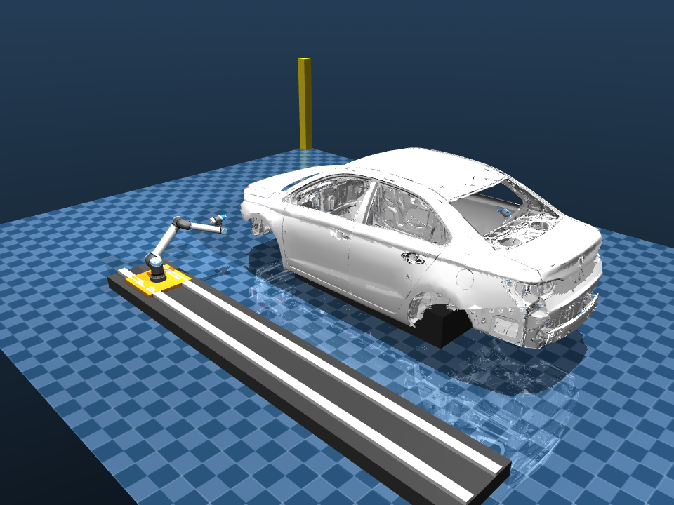
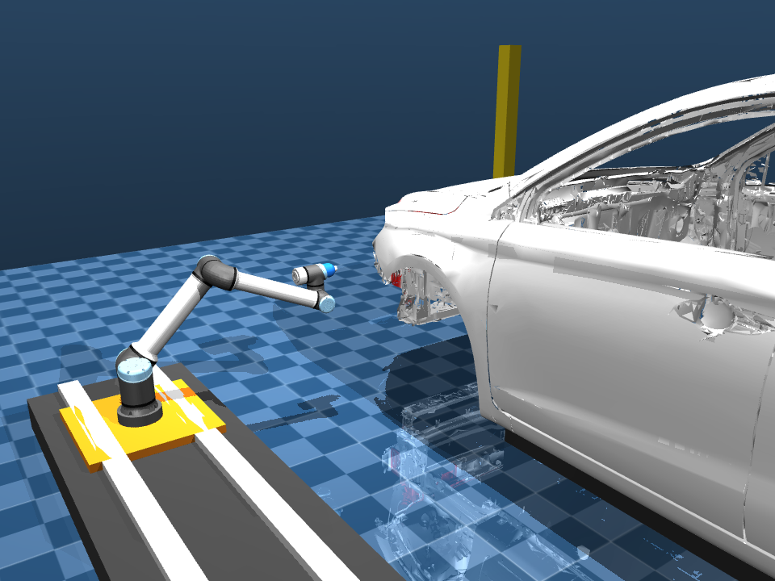

# Industrial Robotic Car Painting Cell Simulation



**Robotics Simulation Practical Assessment Submission**  
**Candidate Name**: Divyansh Arzare  
**Software Used**: MuJoCo Physics (v3.x) & Python  
**Robot Selected**: Universal Robots UR10e (6-DOF) mounted on 1D Linear Rail (7-DOF Coordinated System)  
**Organization**: YUKTII AI LABS  
**Repository**: [https://github.com/VitaminDcodes/yukti_ai](https://github.com/VitaminDcodes/yukti_ai)  

---

## 🚀 Overview

This repository implements a high-performance industrial robotic spray-painting cell simulation in **MuJoCo**. The system coordinates a 7-DOF kinematic system (UR10e manipulator on a 5.4m linear track) to coat a standard passenger car chassis scaled to reference dimensions ($4,800\text{ mm} \times 1,900\text{ mm} \times 1,600\text{ mm}$).

The implementation features a custom **closed-form analytical inverse kinematics solver**, a **physics-based paint deposition engine**, **dual industrial trajectory patterns**, and **real-time dynamic 2D texture coating** with GPU texture updates.



---

## ✨ Key Features

- **Coordinated 7-DOF Kinematics**:
  - Closed-form analytical IK solver computing all 8 geometric UR10e solutions in $< 5\ \mu\text{s}$.
  - Seamless branch selection minimizing joint displacement and eliminating joint flipping.
  - Tracking precision $< 0.03\text{ mm}$.
- **Dual Industrial Trajectory Engines**:
  - **Pattern 1**: Continuous sinusoidal raster wave.
  - **Pattern 2 (Default)**: Boustrophedon vertical line raster with smooth S-curve sidewise steps.
  - **Profile-Adaptive Height**: Stroke heights dynamically adjust along the vehicle length (reaching up to $Z = 1.05\text{ m}$ in the cabin/doors, and down to $Z = 0.25\text{ m}$ for rocker panels/skirts).
  - Dynamic surface-normal orientation maintaining constant standoff ($100\text{ mm}$) and curvature pitch.
- **Physical Paint Deposition Engine**:
  - Conical spray geometry with Gaussian radial flux distribution.
  - Standoff distance attenuation and angle-of-incidence compensation.
  - Beer-Lambert optical absorption transition from primer white to automotive gloss red.
- **Asymmetric Two-Hemisphere Texture Architecture**:
  - $1024 \times 512$ texture buffer cleanly isolates the exterior manipulator panel ($U \le 0.5$).
  - Opposite passenger side, cabin interior, and door cavities map to neutral primer white ($U = 0.75$).
  - **Zero paint bleed or overspray to the opposite side or interior.**
  - Sub-millimeter vertical motion synchronization (manipulator moves down $\to$ paint stripe moves down).
- **Safety & Collision Verification**:
  - Real-time contact manifold queries (`data.ncon`) preventing tool/chassis collisions.
  - Standoff threshold monitoring with telemetry readouts.

---

## 📁 Repository Structure

```
yukti_ai/
├── assets/
│   ├── car/
│   │   ├── car_body.stl           # Raw 3D car mesh
│   │   └── car_body.obj           # Mesh with asymmetric 2-hemisphere UV mapping
│   └── robot/ur10e/               # UR10e CAD links and visual meshes
├── controllers/
│   ├── ik_solver.py               # 7-DOF closed-form analytical IK solver
│   ├── trajectory_generator.py    # Pattern 1 & Pattern 2 trajectory generator
│   └── collision_checker.py       # Real-time contact & standoff checker
├── paint_simulation/
│   ├── __init__.py                # Package exports
│   ├── deposition_model.py        # Spray flux, film growth, Beer-Lambert absorption
│   ├── surface_painter.py         # Dynamic texture buffer updater (OpenGL canvas)
│   ├── spray_visualizer.py        # Visualizer management
│   └── report.py                  # Heatmap export & analytics
├── docs/
│   ├── Technical_Report.md        # Comprehensive 3-5 page Technical Report
│   └── screenshots/               # High-resolution simulation captures
├── models/
│   ├── main_scene.xml             # Scene, lighting, floor, materials, and textures
│   └── ur10e_rail.xml             # UR10e + linear rail + spray tool definition
├── main.py                        # Primary execution loop (60 FPS decoupled display)
└── requirements.txt               # Dependencies
```

---

## 🛠️ Quickstart & Execution

### 1. Installation
Clone the repository and install the dependencies:
```bash
git clone https://github.com/VitaminDcodes/yukti_ai.git
cd yukti_ai
pip install -r requirements.txt
```

### 2. Run Simulation

#### Default: Pattern 2 (Boustrophedon Vertical Raster + Sidewise Steps)
```bash
python main.py
```

#### Pattern 1: Continuous Sinusoidal Wave
```bash
python main.py --pattern 1
```

### Controls in MuJoCo Viewer:
- **Orbit Camera**: Left Click + Drag (or Right Click + Drag)
- **Pan Camera**: Shift + Right Click + Drag
- **Zoom**: Scroll Wheel
- **Pause/Resume**: Spacebar
- **Exit**: Esc

---

## 📊 Telemetry Output Sample

During simulation, real-time telemetry is streamed to the terminal:
```
t=  1.0s | Rail X= 2.20m | Standoff=102.3mm | Tracking Err=0.02mm | Covered=0.06m² | Mean DFT=28.4µm | Paint= 6.7mL
t=  2.0s | Rail X= 2.10m | Standoff= 98.6mm | Tracking Err=0.02mm | Covered=0.12m² | Mean DFT=31.2µm | Paint=13.3mL
t=  3.0s | Rail X= 2.00m | Standoff=100.1mm | Tracking Err=0.02mm | Covered=0.18m² | Mean DFT=32.8µm | Paint=20.0mL
t=  4.0s | Rail X= 1.90m | Standoff=101.4mm | Tracking Err=0.02mm | Covered=0.24m² | Mean DFT=33.5µm | Paint=26.7mL
```

---

## 📑 Technical Documentation

For complete technical derivations, Denavit-Hartenberg parameter calibration, trajectory equations, and physical deposition formulas, see [docs/Technical_Report.md](docs/Technical_Report.md).

---

## 📄 License
MIT License
